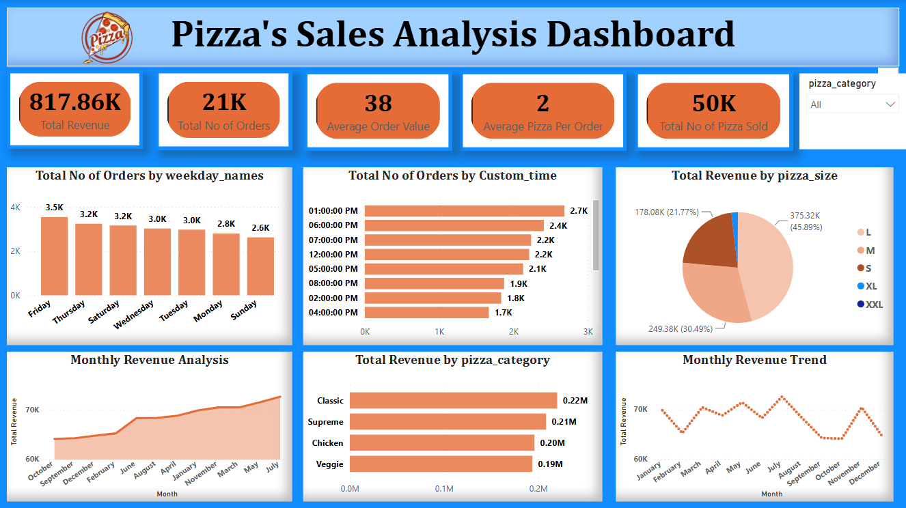

# 🍕 Pizza Sales Analysis Dashboard (Power BI)

An interactive Power BI dashboard that analyses pizza sales data to find revenue trends, best-selling categories and peak order times.

## Dashboard Preview

## Objective
To help a pizza business understand its sales performance and make better decisions about products and staffing.

## Tools Used
- Power BI Desktop
- DAX (measures)
- Data cleaning and modelling in Power BI

## KPIs
- Total Revenue
- Total Number of Orders
- Average Order Value
- Total Pizzas Sold
- Average Pizzas per Order

## Visuals in the Dashboard
- Monthly revenue trend (line and area charts)
- Orders by weekday (column chart)
- Orders by time of day (bar chart)
- Revenue by pizza size (pie chart)
- Revenue by pizza category (bar chart)
- Category slicer to filter the whole dashboard

## Key Insights
- Revenue Analysis: Analyzed total revenue and average order value to understand overall sales performance.
- Monthly Sales Trends: Evaluated monthly revenue trends to identify periods of high and low sales performance.
- Peak Order Time: Analyzed order patterns throughout the day to identify peak hours for pizza sales.
- Pizza Category Performance: Compared revenue across pizza categories to understand their contribution to overall sales.
- Pizza Size Analysis: Examined revenue by pizza size to identify which sizes contribute the most to total revenue.
- Daily Order Trends: Analyzed orders by day of the week to identify the busiest days for pizza sales.

  
## Dataset
Pizza sales data containing order date, pizza category, pizza size, quantity and price.

## Files
- `pizza_sales_anaysis_dashboard.pbix` - Power BI dashboard file
- `dashboard.png` - screenshot of the dashboard

## Author
**Paresh Subhash Sawant**
B.Com Graduate | Aspiring Data Analyst
Email: sawantparesh64@gmail.com
